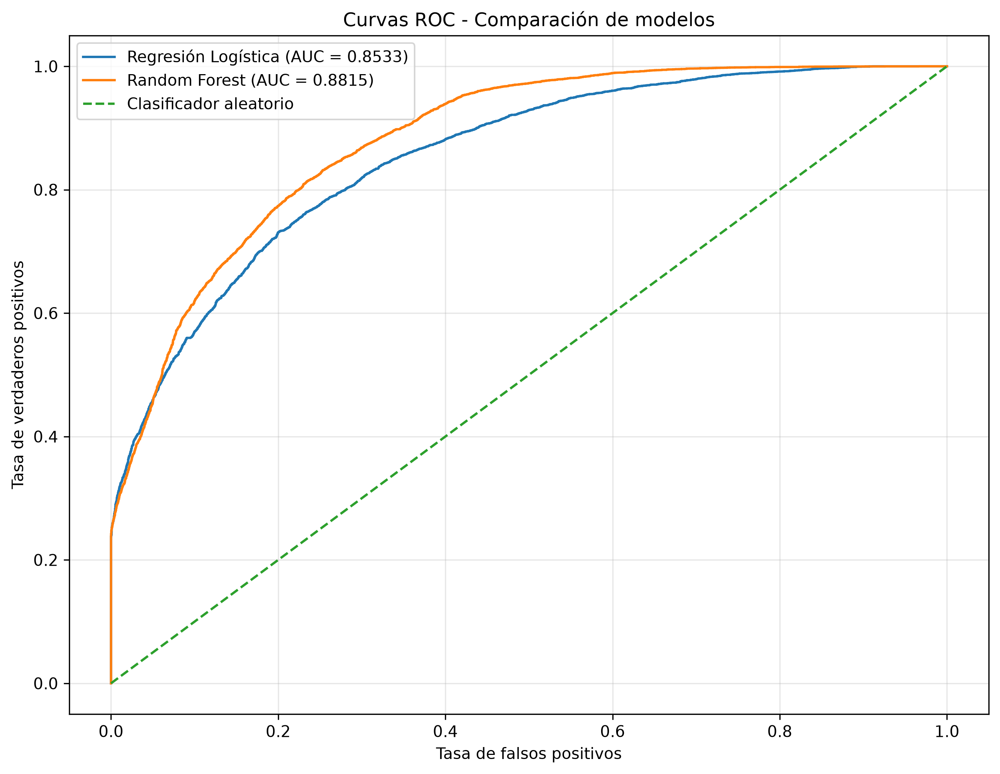
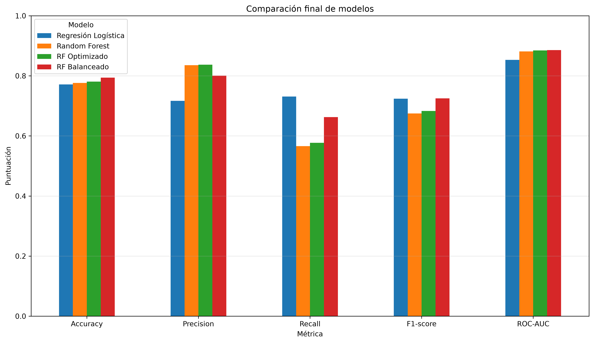
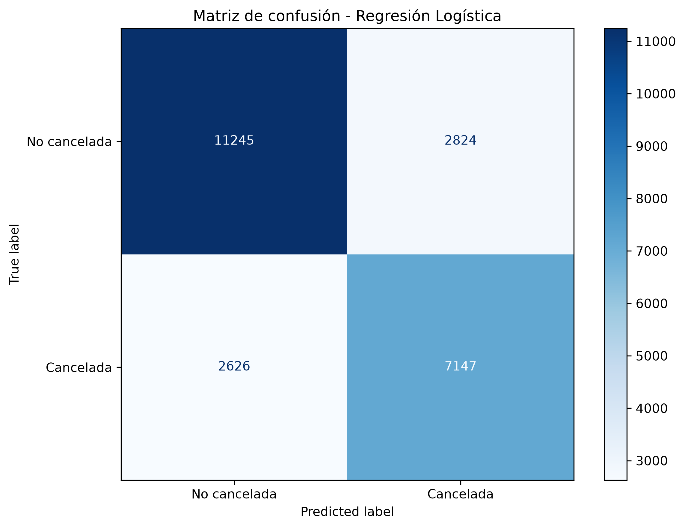
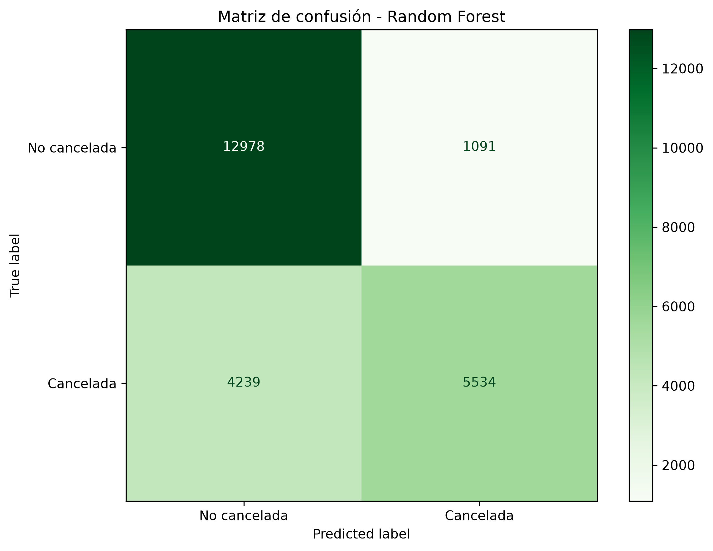
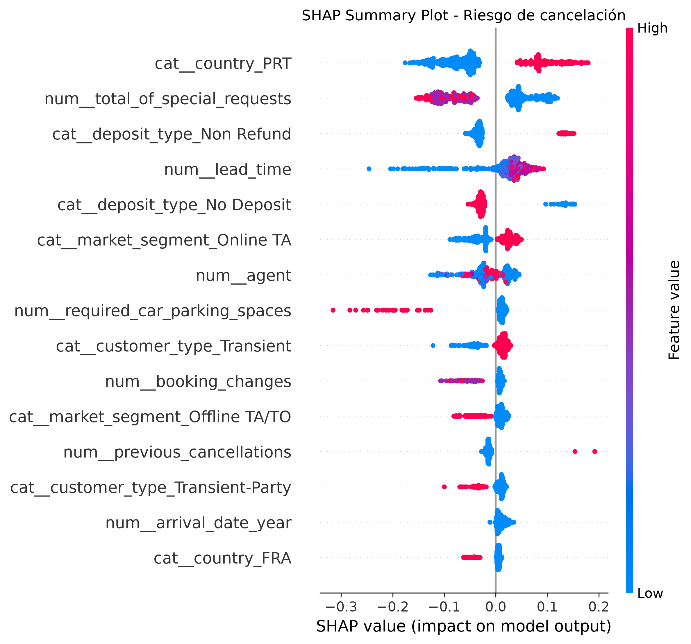
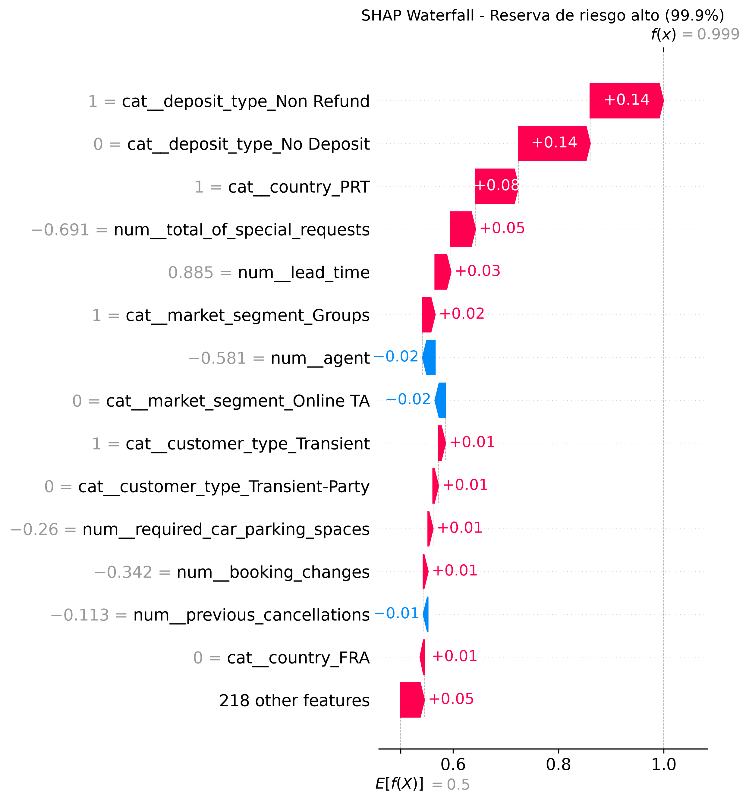
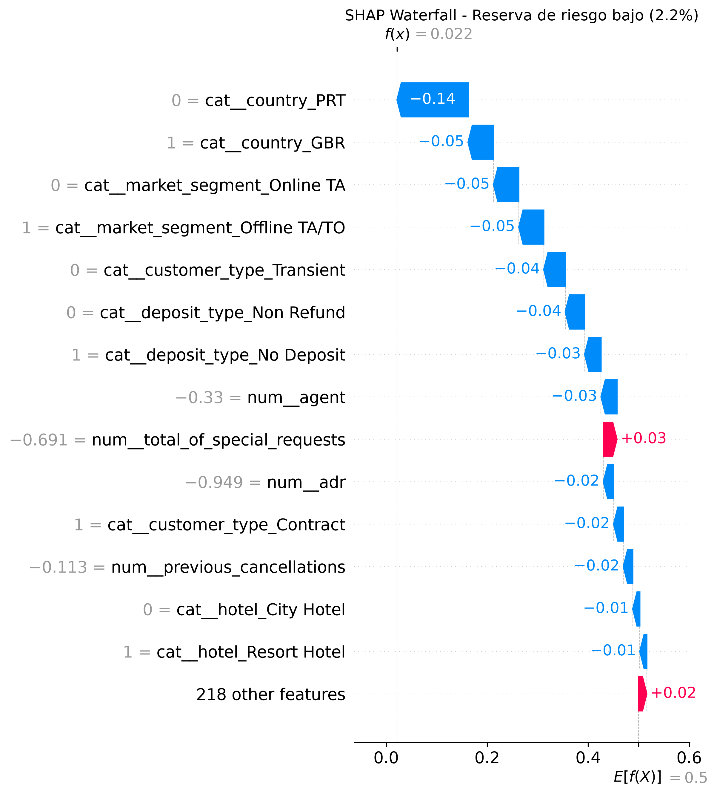

# Predicción de Cancelaciones de Reservas Hoteleras mediante Machine Learning

## Descripción del proyecto

Este proyecto desarrolla un sistema de Machine Learning para analizar y predecir la cancelación de reservas hoteleras.

El objetivo principal consiste en identificar, en el momento de realizar la reserva, aquellas reservas que presentan una mayor probabilidad de cancelación utilizando únicamente información disponible antes de conocer su resultado final.

La predicción anticipada del riesgo puede servir como herramienta de apoyo para la gestión hotelera, permitiendo priorizar determinadas acciones preventivas y mejorar la planificación de la disponibilidad.

Además del rendimiento predictivo, el proyecto presta especial atención a la prevención de *data leakage*, la validación temporal de los modelos, el tratamiento del desbalanceo de clases y la interpretación de las predicciones desde una perspectiva empresarial.

---

## Objetivos

Los principales objetivos del proyecto son:

- Analizar el comportamiento de las reservas hoteleras.
- Identificar patrones asociados a la probabilidad de cancelación.
- Preparar los datos para su utilización mediante algoritmos de Machine Learning.
- Crear nuevas variables con utilidad potencial para el problema de negocio.
- Evitar variables que puedan provocar *data leakage*.
- Realizar una división temporal de entrenamiento y test.
- Entrenar y comparar diferentes modelos de clasificación.
- Optimizar los hiperparámetros de Random Forest.
- Analizar el efecto del desbalanceo de clases.
- Evaluar los modelos mediante Accuracy, Precision, Recall, F1-score y ROC-AUC.
- Interpretar global e individualmente las predicciones mediante SHAP.
- Clasificar las reservas según su nivel estimado de riesgo.
- Traducir los resultados del modelo a posibles decisiones empresariales.

---

## Dataset

El conjunto de datos utilizado contiene información sobre reservas hoteleras y variables relacionadas con:

- características de la reserva;
- fechas de llegada;
- antelación de la reserva (`lead_time`);
- tipo de depósito;
- segmento de mercado;
- canal de distribución;
- país;
- tipo de cliente;
- precio medio diario (`adr`);
- cancelaciones anteriores;
- solicitudes especiales;
- cambios realizados sobre la reserva;
- plazas de aparcamiento solicitadas;
- estado de cancelación.

La variable objetivo utilizada es:

`is_canceled`

donde:

- `0` = reserva no cancelada.
- `1` = reserva cancelada.

El dataset utilizado en el modelado contiene **119.210 registros**.

---

## Análisis Exploratorio de Datos (EDA)

Antes del entrenamiento de los modelos se realizó un análisis exploratorio con el objetivo de comprender la estructura, calidad y comportamiento de los datos.

Entre otros aspectos, se analizaron:

- dimensiones del dataset;
- tipos de variables;
- valores nulos;
- registros duplicados;
- distribución de la variable objetivo;
- cancelaciones según tipo de hotel;
- cancelaciones según el mes;
- cancelaciones según el canal de distribución;
- relación entre `lead_time` y la cancelación;
- diferencias en `adr` entre reservas canceladas y no canceladas;
- evolución temporal de las reservas;
- variables potencialmente relacionadas con el riesgo de cancelación.

También se realizaron controles de calidad para detectar situaciones como reservas sin huéspedes, valores negativos de ADR o estancias de cero noches.

El análisis exploratorio permite entender qué perfiles y características presentan diferencias en sus tasas de cancelación y proporciona el contexto necesario para desarrollar posteriormente los modelos predictivos.

---

## Ingeniería de características

Durante la preparación de los datos se crearon variables adicionales con el objetivo de representar mejor determinadas características de las reservas.

Entre ellas se encuentra:

`total_guests = adults + children + babies`

Esta variable resume en un único atributo el número total de huéspedes asociados a la reserva. Desde una perspectiva empresarial, el tamaño del grupo puede estar relacionado con el comportamiento de la reserva y permite al modelo utilizar esta información de una forma más directa.

También se utilizaron variables auxiliares durante el análisis exploratorio para facilitar la interpretación de determinados patrones. Estas variables de análisis no se incorporaron necesariamente como predictores al modelo final.

---

## Prevención de Data Leakage

Uno de los aspectos fundamentales del proyecto fue evitar que los modelos utilizaran información que solo estaría disponible después de conocerse el resultado de una reserva.

Por este motivo se excluyeron del conjunto de predictores variables como:

- `is_canceled`
- `reservation_status`
- `reservation_status_date`
- `assigned_room_type`

`is_canceled` constituye la variable objetivo, mientras que las restantes pueden contener información conocida después de que se haya producido o resuelto la reserva.

También se excluyeron determinadas variables creadas específicamente durante el análisis exploratorio.

De esta forma, el modelo utiliza información adecuada para realizar predicciones sobre reservas futuras y se evita obtener resultados artificialmente elevados debido a la presencia de información posterior al evento que se pretende predecir.

---

## División temporal Train / Test

Para realizar una evaluación más cercana a un escenario real, se utilizó una división temporal del dataset.

Las reservas fueron ordenadas cronológicamente según su fecha de llegada.

Posteriormente se utilizaron:

- **80 % de los registros más antiguos para entrenamiento.**
- **20 % de los registros más recientes para evaluación.**

### Train

- Registros: **95.368**
- Periodo: **01/07/2015 - 22/04/2017**

### Test

- Registros: **23.842**
- Periodo: **22/04/2017 - 31/08/2017**

Este enfoque permite evaluar los modelos sobre observaciones posteriores a las utilizadas durante el entrenamiento, simulando de forma más realista el uso del sistema para predecir reservas futuras.

---

## Preprocesamiento

El preprocesamiento se implementó mediante herramientas de `scikit-learn`.

Para las variables numéricas se aplicaron:

- imputación mediante la mediana;
- estandarización mediante `StandardScaler`.

Para las variables categóricas se aplicaron:

- imputación mediante la categoría más frecuente;
- codificación mediante `OneHotEncoder`.

Todo el preprocesamiento se integró mediante `Pipeline` y `ColumnTransformer`.

Este enfoque permite aplicar exactamente las mismas transformaciones durante el entrenamiento y durante la predicción sobre nuevos datos, reduciendo errores y mejorando la reproducibilidad del proyecto.

---

## Modelos utilizados

Se evaluaron diferentes configuraciones de modelos de clasificación.

### Regresión Logística

Se utilizó como modelo base interpretable y como referencia para comparar el rendimiento de modelos más complejos.

### Random Forest

Se utilizó un modelo basado en múltiples árboles de decisión con el objetivo de capturar relaciones no lineales e interacciones entre las variables.

### Random Forest optimizado

Se realizó una búsqueda de hiperparámetros mediante `RandomizedSearchCV`, utilizando ROC-AUC como métrica de optimización.

Los mejores hiperparámetros obtenidos fueron:

- `n_estimators = 300`
- `max_depth = None`
- `min_samples_split = 2`
- `min_samples_leaf = 4`
- `max_features = "sqrt"`

El mejor ROC-AUC obtenido durante la validación fue aproximadamente **0.9067**.

### Random Forest balanceado

Finalmente se evaluó una variante del Random Forest utilizando:

`class_weight="balanced"`

El objetivo fue dar mayor consideración a la clase minoritaria durante el entrenamiento y analizar si era posible mejorar la detección de cancelaciones sin deteriorar excesivamente la precisión del modelo.

---

## Resultados

Los modelos fueron evaluados mediante Accuracy, Precision, Recall, F1-score y ROC-AUC.

| Modelo | Accuracy | Precision | Recall | F1-score | ROC-AUC |
|---|---:|---:|---:|---:|---:|
| Regresión Logística | 0.7714 | 0.7168 | **0.7313** | 0.7240 | 0.8533 |
| Random Forest | 0.7764 | 0.8353 | 0.5663 | 0.6750 | 0.8815 |
| Random Forest optimizado | 0.7806 | **0.8370** | 0.5771 | 0.6832 | 0.8845 |
| Random Forest balanceado | **0.7941** | 0.8007 | 0.6625 | **0.7251** | **0.8856** |

Los resultados muestran que no existe un único modelo que domine en todas las métricas.

El **Random Forest balanceado** obtiene el mayor ROC-AUC (**0.8856**), la mayor Accuracy (**0.7941**) y el mayor F1-score (**0.7251**), ofreciendo un equilibrio adecuado entre capacidad discriminativa y detección de cancelaciones.

El **Random Forest optimizado** alcanza la mayor Precision (**0.8370**), mientras que la **Regresión Logística mantiene el mayor Recall (0.7313)** para la clase cancelada.

Considerando conjuntamente las métricas y el problema empresarial, se selecciona el **Random Forest balanceado como modelo final**.

Aunque la Regresión Logística presenta un Recall superior, el Random Forest balanceado mantiene una Precision elevada (**0.8007**), mejora considerablemente el Recall respecto a los otros modelos Random Forest y consigue los mejores valores de Accuracy, F1-score y ROC-AUC entre las alternativas evaluadas.

---

## Curvas ROC

Las curvas ROC permiten comparar la capacidad de discriminación de los modelos iniciales para diferentes umbrales de clasificación.



Los valores obtenidos fueron:

- Regresión Logística: **ROC-AUC = 0.8533**
- Random Forest: **ROC-AUC = 0.8815**

El Random Forest inicial presenta una mayor capacidad de discriminación que la Regresión Logística. Posteriormente, esta capacidad se mejoró mediante la optimización de hiperparámetros y el tratamiento del desbalanceo de clases.

---

## Comparación de modelos



La comparación final incluye los cuatro modelos evaluados: Regresión Logística, Random Forest, Random Forest optimizado y Random Forest balanceado.

Los resultados muestran diferentes compromisos entre las métricas:

- **Regresión Logística:** mayor Recall (**0.7313**).
- **Random Forest:** Precision elevada (**0.8353**) y ROC-AUC superior al de la Regresión Logística.
- **Random Forest optimizado:** mayor Precision (**0.8370**) y ROC-AUC de **0.8845**.
- **Random Forest balanceado:** mayor Accuracy (**0.7941**), mayor F1-score (**0.7251**) y mayor ROC-AUC (**0.8856**).

El Random Forest balanceado mejora además notablemente el Recall respecto a las otras variantes de Random Forest.

Por estos motivos se utiliza como **modelo final del proyecto**.

---

## Matrices de confusión

### Regresión Logística



La Regresión Logística alcanza un Recall de **0.7313**, por lo que identifica aproximadamente el **73,13 % de las cancelaciones reales** del conjunto de test.

### Random Forest



El Random Forest inicial presenta una Precision elevada (**0.8353**), aunque su Recall (**0.5663**) indica que deja sin detectar una proporción mayor de cancelaciones reales.

Esta diferencia entre Precision y Recall pone de manifiesto la importancia de considerar el coste empresarial de los falsos negativos y falsos positivos.

---

## Interpretabilidad mediante SHAP

Para interpretar el comportamiento del modelo final se utilizó **SHAP (SHapley Additive exPlanations)**.

SHAP permite analizar tanto la importancia global de las variables como la contribución de cada característica a predicciones individuales.

### Interpretación global



El análisis global muestra que entre las características que tienen una influencia relevante en las predicciones del modelo aparecen variables relacionadas con:

- país de origen;
- número de solicitudes especiales;
- tipo de depósito;
- `lead_time`;
- segmento de mercado;
- agente;
- plazas de aparcamiento solicitadas;
- tipo de cliente;
- cambios en la reserva;
- cancelaciones anteriores.

Estas asociaciones describen cómo utiliza el modelo la información disponible. No deben interpretarse necesariamente como relaciones causales con la cancelación.

### Reserva de alto riesgo



Como ejemplo de interpretación individual, el modelo identificó una reserva con una probabilidad estimada de cancelación de aproximadamente **99,93 %**.

Entre sus características se encuentran:

- City Hotel;
- `lead_time` de **189 días**;
- país: **PRT**;
- segmento de mercado: **Groups**;
- canal de distribución: **TA/TO**;
- depósito: **Non Refund**;
- ausencia de solicitudes especiales.

En esta reserva concreta, SHAP muestra que características como el tipo de depósito, el país, la elevada antelación y el segmento de mercado contribuyen a aumentar la predicción de riesgo.

Estas contribuciones representan asociaciones aprendidas por el modelo y no implican que dichas características sean por sí mismas la causa de la cancelación.

### Reserva de bajo riesgo



Como contraste, se analizó una reserva con una probabilidad estimada de cancelación de aproximadamente **2,16 %**.

Entre sus características aparecen:

- Resort Hotel;
- `lead_time` de **72 días**;
- país: **GBR**;
- segmento de mercado: **Offline TA/TO**;
- canal de distribución: **TA/TO**;
- depósito: **No Deposit**;
- tipo de cliente: **Contract**.

La explicación SHAP muestra que la combinación de estas características desplaza la predicción hacia un menor riesgo de cancelación.

### Conclusión de interpretabilidad

Los resultados muestran que el riesgo estimado no depende de una única variable, sino de la combinación de diferentes características de cada reserva.

La utilización de SHAP permite no solo generar una probabilidad de cancelación, sino también explicar qué factores han contribuido a esa predicción concreta, facilitando un uso más transparente del modelo como herramienta de apoyo empresarial.

---

## Segmentación del riesgo de cancelación

A partir de las probabilidades estimadas por el modelo se construyó una clasificación de riesgo en tres niveles.

| Nivel de riesgo | Reservas | Tasa real de cancelación |
|---|---:|---:|
| Bajo | 12.320 | 5,37 % |
| Medio | 5.933 | 48,51 % |
| Alto | 5.589 | 94,85 % |

Esta segmentación muestra una separación clara entre los distintos grupos de riesgo.

Las reservas clasificadas como riesgo alto presentan una tasa real de cancelación muy elevada, mientras que las clasificadas como riesgo bajo presentan una tasa considerablemente menor.

Desde una perspectiva empresarial, esta segmentación permite transformar una probabilidad estadística en categorías más sencillas de utilizar en procesos operativos.

---

## Aplicación empresarial

El modelo puede utilizarse como una herramienta de apoyo para estimar el riesgo de cancelación de una reserva en el momento en que se dispone de sus características.

Una posible utilización sería asignar a cada nueva reserva una probabilidad de cancelación y clasificarla posteriormente en diferentes niveles de riesgo.

En función del riesgo estimado, el hotel podría valorar acciones como:

- ofrecer incentivos o mejoras selectivas a determinadas reservas;
- valorar depósitos o condiciones de reserva específicas en perfiles de riesgo elevado;
- ajustar de forma prudente la estrategia de disponibilidad y overbooking;
- priorizar el seguimiento de reservas con mayor riesgo;
- mejorar la planificación de ocupación;
- apoyar la gestión de ingresos.

Estas actuaciones deberían evaluarse mediante pruebas controladas antes de implantarse de forma generalizada, ya que una predicción de riesgo no implica que una reserva vaya a cancelarse necesariamente.

Los **falsos negativos** pueden provocar que el hotel no detecte cancelaciones que finalmente se producen, mientras que los **falsos positivos** pueden generar actuaciones innecesarias sobre clientes que finalmente habrían mantenido su reserva.

Por este motivo, el modelo debe entenderse como una **herramienta de apoyo a la decisión y no como un sistema automático de penalización del cliente**.

---

## Próximos pasos

Como continuación del proyecto se podrían estudiar diferentes líneas de mejora:

- ajustar el umbral de clasificación en función del coste real de falsos positivos y falsos negativos;
- comparar algoritmos adicionales de Machine Learning;
- incorporar información adicional disponible en el momento de la reserva;
- analizar la estabilidad temporal del modelo;
- realizar una validación con datos más recientes;
- estudiar el impacto económico real de las acciones preventivas;
- realizar experimentos controlados para determinar qué acciones reducen realmente las cancelaciones;
- monitorizar posibles cambios en los patrones de comportamiento de los clientes.

La elección del umbral de decisión debería realizarse en función de los costes y beneficios reales de cada actuación empresarial.

---

## Estructura del proyecto

```text
ml-cancelaciones-hoteleras/
│
├── data/
│   └── reservas_hoteleras.xlsx
│
├── notebooks/
│   └── cancelaciones_hoteleras_ml.ipynb
│
├── outputs/
│   └── figures/
│       ├── comparacion_final_modelos.png
│       ├── curvas_roc.png
│       ├── matriz_confusion_logistica.png
│       ├── matriz_confusion_random_forest.png
│       ├── riesgo_cancelacion.png
│       ├── shap_summary.png
│       ├── shap_waterfall_riesgo_alto.png
│       └── shap_waterfall_riesgo_bajo.png
│
├── presentation/
│
├── .gitignore
├── README.md
└── requirements.txt
```

---

## Tecnologías utilizadas

- Python
- Pandas
- NumPy
- Matplotlib
- Scikit-learn
- SHAP
- Jupyter Notebook
- OpenPyXL

---

## Instalación y ejecución

Para instalar las dependencias necesarias:

```bash
pip install -r requirements.txt
```

Posteriormente se puede ejecutar el notebook ubicado en:

```text
notebooks/cancelaciones_hoteleras_ml.ipynb
```

El notebook está diseñado para ejecutarse de principio a fin siguiendo el flujo completo de análisis, preparación, entrenamiento, evaluación e interpretación de los modelos.

---

## Conclusiones

El proyecto muestra que es posible identificar patrones asociados al riesgo de cancelación de reservas hoteleras mediante técnicas de Machine Learning utilizando información disponible antes de conocer el resultado final de la reserva.

Se evaluaron cuatro alternativas: Regresión Logística, Random Forest, Random Forest optimizado mediante búsqueda de hiperparámetros y Random Forest con balanceo de clases.

El **Random Forest balanceado** fue seleccionado como modelo final al obtener la mayor Accuracy (**0.7941**), el mayor F1-score (**0.7251**) y el mayor ROC-AUC (**0.8856**) entre las alternativas evaluadas, manteniendo además una Precision de **0.8007** y un Recall de **0.6625**.

La **Regresión Logística** obtiene el mayor Recall (**0.7313**), demostrando que la selección de un modelo no debe realizarse únicamente a partir de una métrica. La decisión depende del equilibrio que se quiera establecer entre detectar cancelaciones y evitar falsas alarmas.

La optimización de hiperparámetros mejoró el rendimiento del Random Forest inicial, mientras que el tratamiento del desbalanceo permitió aumentar de forma considerable su capacidad para detectar cancelaciones.

El análisis mediante **SHAP** permitió identificar qué características tienen mayor influencia en las predicciones globales y explicar reservas individuales con niveles de riesgo muy diferentes.

Desde una perspectiva empresarial, el modelo podría utilizarse para asignar un nivel de riesgo a las nuevas reservas y apoyar acciones preventivas selectivas. La utilidad real de dichas acciones debería validarse teniendo en cuenta sus costes, beneficios y posibles efectos sobre la experiencia del cliente.

El proyecto integra análisis exploratorio, ingeniería de características, prevención de *data leakage*, validación temporal, preprocesamiento mediante pipelines, comparación de modelos, optimización de hiperparámetros, tratamiento del desbalanceo e interpretabilidad mediante SHAP para construir una solución reproducible y orientada a un problema empresarial real.